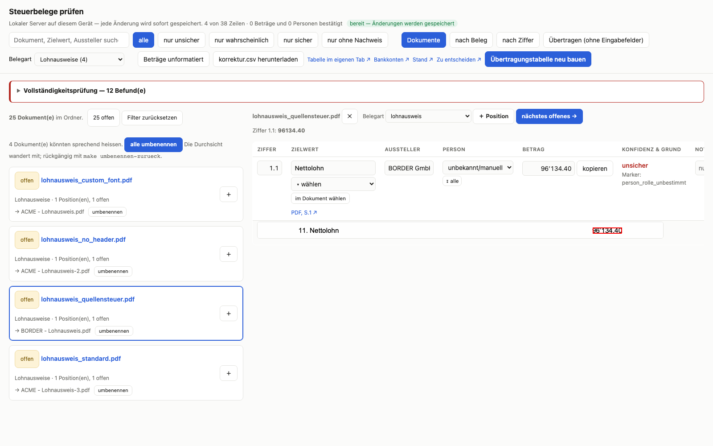

# swiss-tax-document-extractor


Turn a folder of Swiss tax documents (PDF) into one transfer table for the Canton of Zurich tax return. Every amount is anchored to the exact words on the original page, and nothing leaves your machine.

> **About this repository:** Public, sanitised snapshot of a private working repo that the author uses for a real tax return in the Canton of Zurich. The code is the same apart from anonymised names and markers; this repo ships without the private evaluation corpus of anonymised real documents and without the planning notes. Synthetic test documents for every supported type can be generated locally with `python -m evals.generate`.



*The local review UI on synthetic test documents (`python -m evals.generate`); no real person or document is shown.*

---

## The Problem

Filing a Swiss tax return means collecting a stack of PDFs (salary certificates, bank interest statements, health-insurance premium statements, pillar 3a confirmations, donation receipts, childcare invoices) and typing the right number from each one into the right field of the cantonal software (ZHprivateTax) or a spreadsheet for the tax advisor.

Three things go wrong every year:

- **Manual transfer is slow and error-prone.** Twenty documents, one number each, and one of them is the gross invoice amount instead of your own share.
- **Trust.** A number extracted by a language model is worthless unless you can check it against the original page in seconds.
- **Forgetting.** The bank that sent a statement last year but not this year is invisible until the tax office asks.

---

## The Solution

One run, one table, every value with an anchor back to the original document.

```
belege/*.pdf  ->  extraction  ->  steuer_uebertragung.md   (the transfer table)
                              ->  nachweis_anhang.md       (page + bounding box + snippet per value)
                              ->  steuer_extraktion_debug.md (everything, for tool development)
```

- **`steuer_uebertragung.md`**: the transfer table for ZHprivateTax or the tax advisor, in three sections: automatically transferable, check manually, out of scope. Columns: tax area, ZHprivateTax field number, person/role, issuer, description, amount CHF, year, source, status.
- **`nachweis_anhang.md`**: for every transferred position: page, bounding box, verbatim snippet, plausibility findings, and where the value came from (rule, model, human, or computed). Lets you verify each number word by word in the original PDF.
- **`steuer_extraktion_debug.md`**: all fields per document including confidence and anchors; useful for development and evaluation, not for filing.

A local **review UI** (`make review`, bound to `127.0.0.1` only, write access protected by a per-start token) is where the human work happens. Confirmed or corrected values are written to `korrekturen.json` and become expected values that every later run is checked against. That is the correction loop. Checked positions then move into a locked position store (see *Checked values are stored, not recomputed* below), and the transfer table reads them from there word for word.

It opens on a **document overview**: one row per PDF in the folder, with the state spelled out as a word as well as a colour: *checked · open · nothing found · excluded · not read in*. The list starts from the **folder**, not from the extraction result; only that way does "it is lying there and was never read" exist as a state at all. The counters double as filters, as does the document type.

The right-hand pane holds exactly one document: its positions, the sum per field number as a cross-check against the total printed on the document, the page image with clickable words, and "next open one →".

**Several positions of the same kind per document.** A mortgage statement lists three mortgages; extraction finds one. `＋ Position` records the others. Each carries its running number in the key (`<document>|<target value>#2`), and a short distinguishing label ("fixed-rate 0.95 %") keeps them apart. Numbers once assigned never shift. If they did, a confirmed amount would point at a different mortgage after a deletion, and the check would still report *matches*.

**Speaking filenames.** Once issuer and document type are settled, the UI proposes a name and renames the original at the press of a button:

```
2025_tax_statement4.9.2026155454.pdf
      ->  Bank A - Vermoegensausweis Zinsausweis - Erika Muster 2025.pdf
```

The document type comes from the target values actually **found**, not from the document class: a bank statement showing both a balance and interest income is both. The filename is also the key the whole review hangs on, so the word-level JSON, the extraction result and every confirmed value move with it in one step. Every rename is journalled and reversible.

---

## Design principles

**Rule before model.** Standardised or clearly labelled documents (the federal salary certificate *Form 11*, the pillar 3a certificate *Form 21*) are handled by deterministic layout extractors that work on word geometry: amount column, and a cross-check that gross minus deductions equals net. The language model is reserved for free-form documents. Every value carries its provenance (`regel` = rule, `modell` = model, `mensch` = confirmed by a human); only rule values with an anchor and no plausibility finding reach the confidence level *certain*.

**Every value has a text anchor.** Extraction works on word-level bounding boxes from `pdfplumber`. A value without an anchor is marked `unverified`; a computed value is marked `derived`, never presented as anchored.

**The field contract decides what appears in the table.** `extractors/zielwerte.py` is the single source for which value belongs to which ZHprivateTax field number. A test enforces that schema, transfer map and contract stay aligned; what the contract does not know does not appear.

**Nothing gets forgotten.** Issuers are tracked year over year (`aussteller.json`); an issuer present last year but missing in the current run raises a warning. A separate completeness check reports what should be there but is not.

**Checked values are stored, not recomputed.** The transfer table used to be a by-product of every run: extraction rows and review results were joined on document name, target value and position number, and whenever one of the three shifted (a rename, a new position, a moved document), a checked amount lost its row. Now every position gets an identifier once, in a SQLite store (`extractors/ablage.py`), and a checked position is read verbatim without asking the extraction again. SQLite triggers enforce the rules rather than the care of the code above them: a checked row rejects updates to its value fields and deletion, and a group marked complete rejects further positions. Changing a checked value means releasing it explicitly, like reopening a closed accounting period. `make nachweis` then looks for every stored amount in the word-level JSON of its document, so hand-entered values are anchored too.

**Filling in the form without retyping.** A small browser extension for Brave (`extension/`) sits next to ZHprivateTax, shows the checked values in the order of the forms and, on a click, puts one into the field that last had focus. It knows none of the form's fields; the human picks the place, so it survives any redesign of the page and cannot write to the wrong field. It sets the value through the native setter and fires `input` and `change`, because a plain `el.value = …` looks filled in but is lost on save. Totals the form computes itself (fields 4, 12, 30.1, 34) are shown as check figures without a button, since entering them would double them. Its only permission is `storage`; it makes no network requests and reads the values from a local file (`make extension-daten`).

**Silence never means delete.** The review is hours of work and the one part no run can reproduce. A copy of `korrekturen.json` is written to a history folder before every save, and the restore point taken at session start is marked and never rotated away. Withdrawing a value sets a tombstone and lifting a deletion writes an explicit `false`, because absence does not survive a merge: an older backup would simply resurrect what the human had removed. `make staende` lists the earlier states, `make zurueckrollen` restores one (backing up the current one first), and it refuses to run while a review is open, since the page in the browser would write the old state straight back.

---

## Privacy architecture

- **PDFs never leave the machine.** The default extraction engine is a local Ollama model (`qwen2.5:7b-instruct-q4_K_M`) with constrained JSON output. The productive run refuses to start with a cloud engine.
- **No cloud engine.** `--engine cloud` is reserved for a later phase and currently stops with an error; extraction runs only locally.
- **The evaluation corpus is anonymised before it is ever read by a test.** `scripts/anonymize_belege.py` replaces persons, institutions, IBANs, addresses and phone numbers with stable markers (`BANK-A`, `KK-B`, …) while preserving bounding boxes; a privacy gate scans the result and fails on any residue.
- **One pattern library.** `extractors/pii_patterns.py` is the single source of truth for PII detection: the anonymiser, the privacy gate and the public-sync verifier of this repository all import it.
- **OCR fallback stays local** (`ocrmypdf` + `tesseract`) for scanned PDFs.

---

## Quality gate

`scripts/grade_run.py` is the only definition of done for a sample run. It exits 0 only when all 20 checks pass, among them:

- no PII residue in the anonymised sample folder or in the transfer table
- 100 % of extracted values anchor-validated
- every focus target value appears in the transfer table
- automatic rows carry no `manual_review:*` markers; manual rows are counted, documented and machine-readable
- no wealth position that is merely a duplicated interest amount
- person roles restricted to the allowed set; person-sensitive areas never auto-transferred with an unknown person
- issuers appear only as stable anonymised markers
- confirmed values from the review UI are still hit: the one check that verifies the *number*, not just the structure

---

## Supported document types

Salary certificate (Form 11) · bank interest statement · securities register / custody statement · health-insurance premium statement · pillar 3a certificate (Form 21) · donation receipt · professional expenses / further education · childcare (daycare, after-school) · mortgage interest confirmation · property maintenance · medical expenses (health-insurance cost sharing)

---

## Setup

```bash
# with uv
uv sync --extra dev

# or with a plain venv
python3 -m venv .venv && source .venv/bin/activate
pip install -e ".[dev]"

# local extraction model (name must match DEFAULT_MODEL in extractors/llm_extract.py)
ollama pull qwen2.5:7b-instruct-q4_K_M

# synthetic test documents
python -m evals.generate
```

Optional: `pip install -e ".[ocr]"` for the scan fallback.

---

## Usage

```bash
# productive local run: real PDFs in ./belege/ -> transfer table in ./output/latest/
uv run python scripts/run_productive_local.py --input belege --output output/latest

# review and correct values in the browser (localhost only)
make review

# rebuild the transfer table from confirmed corrections without re-extracting
make tabelle

# is the return ready to be filled in?  (completeness against the field contract)
make bereit

# find every stored amount in its original document (JETZT=1 writes the anchors)
make nachweis

# export the checked values for the browser extension (local file, real amounts)
make extension-daten

# give the original PDFs speaking filenames (JETZT=1 actually performs it)
make umbenennen

# earlier states of the review, and a way back to one of them
make staende
make zurueckrollen AUF=...

# sample path on an anonymised corpus + the 20-check grader
make samples
make grade
```

`make help` lists every target with a short description.

---

## Tests

```bash
uv run pytest            # deterministic suite, no Ollama required
uv run pytest -m llm_full   # full extraction evaluation against Ollama
```

The evaluation harness generates synthetic PDFs per document type with known values (`evals/expected/`) and measures field recall, precision, anchor validity and confidence calibration.

### Measured result on synthetic documents

`make eval-synthetisch` generates the 25 synthetic PDFs, runs the productive pipeline over them with the local model and compares every extracted value with the value the PDF was generated from. Last run: 2026-11-17, `qwen2.5:7b-instruct-q4_K_M` via Ollama.

| Document type | Fixtures | Values correct |
|---|---:|---:|
| Salary certificate (Form 11) | 4 | 25/25 |
| Bank interest statement | 3 | 11/14 |
| Securities register | 2 | 7/9 |
| Health-insurance premiums | 2 | 5/5 |
| Medical expenses | 2 | 6/6 |
| Pillar 3a certificate | 2 | 5/5 |
| Donation receipt | 2 | 6/8 |
| Professional expenses / further education | 2 | 5/5 |
| Childcare | 2 | 6/6 |
| Mortgage interest | 2 | 8/8 |
| Property maintenance | 2 | 10/10 |
| **Total** | **25** | **94/101 (93 %)** |

Across all documents, 84 of 84 mandatory fields were found and 138 of 142 extracted values carry a valid text anchor.

How to read it: a value counts as correct when the expected amount or date appears in the extracted value (thousands separators ignored). Names of persons and institutions are not counted. The synthetic documents have clean layouts, so this is a regression baseline for the pipeline, not a claim about accuracy on real scans; misses are the reason the review UI exists.

---

## Tech stack

| Choice | Why |
|--------|-----|
| **Python 3.11+** | Rich PDF ecosystem |
| **pdfplumber** | Text *with* per-word bounding boxes, which the anchor requirement needs |
| **ocrmypdf + tesseract** | Local, idempotent fallback for scanned PDFs |
| **Ollama + qwen2.5:7b-instruct-q4_K_M** | Default extractor; local, structured JSON output via format constraint |
| **pydantic v2** | One schema per document type; validates and serialises extraction results |
| **rich** | CLI tables with confidence colouring |
| **pytest** | Evaluation harness against synthetic fixtures |
| **openpyxl** | Spreadsheet export of the tax summary |
| **zxing-cpp + pypdf** | Read Swiss e-tax statements (eCH-0196): PDF417 barcode and embedded XML |
| **sqlite3** (standard library) | Position store with triggers that lock checked values |
| **Browser extension** (Manifest V3, plain JS) | Puts checked values into ZHprivateTax on a click; permission `storage` only |

**Deliberately not used:** LangChain / LlamaIndex (overkill for schema-constrained extraction), cloud OCR (privacy), vector databases (documents are categorisable by issuer pattern, no semantic search needed).

Code comments and user-facing output are in German (Swiss spelling) because the target software and the documents are.

---

## License

Licensed under the [MIT License](LICENSE).

Contributions welcome: open an issue or a pull request.
